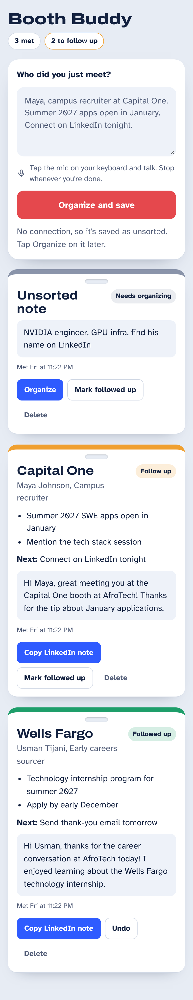
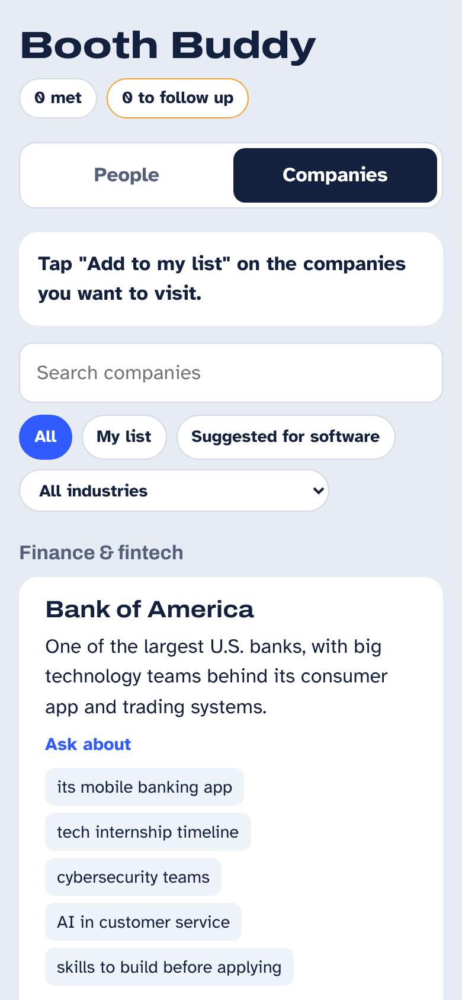
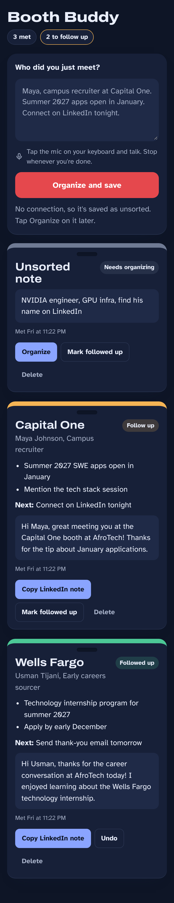
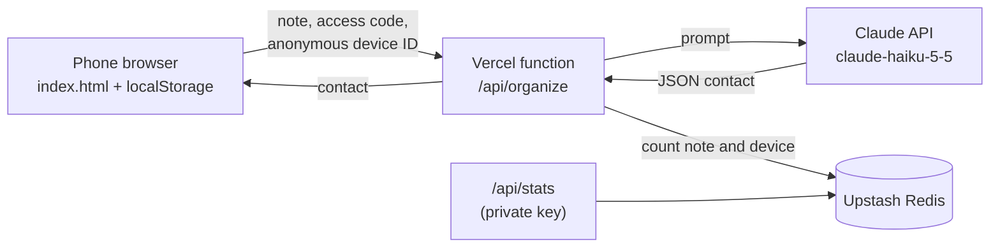

# Booth Buddy

Talk for 30 seconds after meeting a recruiter. AI turns your messy notes into a contact badge with the key points, your next step, and a ready-to-send LinkedIn note.

I built this for AfroTech 2026 in Houston, where I met recruiters at dozens of booths in a few days and needed a fast way to remember every conversation.

**Live:** [boothbuddy-app.vercel.app](https://boothbuddy-app.vercel.app)

  
  
  

## Features

**People**
- **One box, one button.** Dictate with your phone's keyboard mic, tap *Organize and save*.
- **AI organizes it.** Name, company, role, key points, next step, and a LinkedIn note under 280 characters.
- **Never loses a note.** Notes save on the phone before the AI runs. If conference Wi-Fi drops, the note is kept as *Unsorted* and you organize it later with one tap.
- **Follow-up tracking.** Each badge's lanyard color shows its status: amber to follow up, green when done, grey when unsorted.

**Companies**
- **All 63 AfroTech 2026 exhibitors** from the official Expo list, plus Wells Fargo's recruiting lounge, each with a one-line description and its pavilion or lounge.
- **Build your list** of companies to visit, mark them visited, and track progress.
- **Ideas for your chat:** five company-specific topics to bring up, hidden until you want them, so nobody sounds scripted.
- **Write a note** jumps to the note box with the company name filled in.

**Everywhere**
- Phone and laptop layouts, light and dark mode, works as a home screen app.
- An access code keeps the AI for invited users only.

## Architecture

1. The page saves the raw note in `localStorage`, then sends it to `/api/organize`.
2. The function checks the access code, asks Claude for one JSON object, and pulls the JSON out of the reply.
3. It counts the note and an anonymous device ID in Redis, then returns the contact.
4. The page merges the contact into the saved note and redraws the badge.

The API key and access code live only in Vercel environment variables, never in the page or this repo.

## Engineering

- **21 automated tests** (Node's built-in test runner, no dependencies) cover the access code, input checks, parsing the AI's reply, error handling, usage counting, the stats page, Houston-time day boundaries, the company data, and a check that no secret ever appears in the code.
- **CI with GitHub Actions** runs every test on every push and pull request.
- **Postmortem:** on October 31, a stray line broke AI organizing for about 15 minutes. No notes were lost. [Read what happened and what changed](docs/postmortem-2026-10-31.md). The tests now catch that exact bug.
- **Privacy by design:** notes and contacts never leave the phone except to be organized. Usage stats store only random device IDs and counts.

## Files

| File | What it does |
| --- | --- |
| `index.html` | The interface: note box, badges, Companies tab, storage |
| `companies.js` | The AfroTech exhibitor list with descriptions and topics |
| `api/organize.js` | Serverless function: access code, Claude API call, JSON parsing |
| `api/stats.js` | Private usage numbers: users, notes, returning users, by day |
| `lib/redis.js` | Small helper for the Redis usage counters |
| `tests/` | Automated tests run by CI |
| `docs/` | Postmortem |

## What I'd build next

- Personalized questions and a pitch for each company, based on your own profile
- Scan a business card or badge with AI vision
- Rehearse a booth conversation with an AI recruiter
- A one-tap conference recap with top leads and a follow-up plan

## Credits

Built with help from Claude, Anthropic's AI assistant, for planning, code, and debugging.
