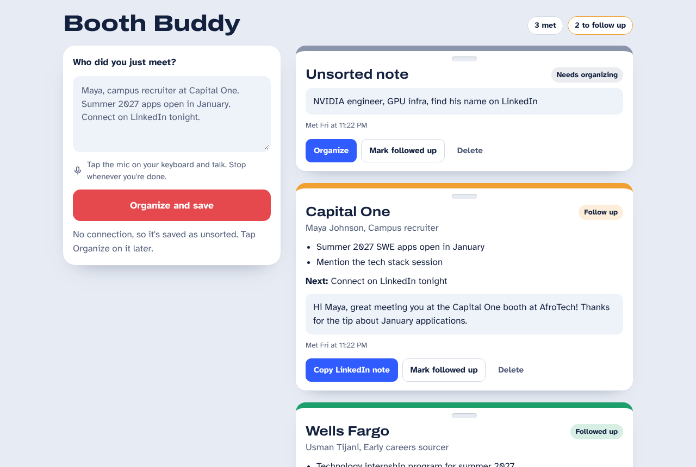

# Booth Buddy

Talk for 30 seconds after meeting a recruiter. AI turns your messy notes into a contact badge with the key points, your next step, and a ready-to-send LinkedIn note.

I built this for AfroTech 2026 in Houston, where I met recruiters at dozens of booths in a few days and needed a fast way to remember every conversation.

<p>
  
  
</p>


## Features

- **One box, one button.** Dictate with your phone's keyboard mic, tap *Organize and save*.
- **AI organizes it.** Name, company, role, key points, next step, and a LinkedIn note under 280 characters.
- **Never loses a note.** Notes save before the AI runs. If conference Wi-Fi drops, the note is kept as *Unsorted* and you organize it later with one tap.
- **Drafts survive.** Close the page mid-note and it's still there when you come back.
- **Follow-up tracking.** Each badge's lanyard color shows its status: amber to follow up, green when done, grey when unsorted.
- **Phone and laptop layouts, light and dark mode.**

## How it works

```
phone keyboard mic → index.html → /api/organize (Vercel function) → Claude API → JSON → saved in the browser
```

1. `index.html` saves the raw note in `localStorage`, then sends it to `/api/organize`.
2. `api/organize.js` runs on Vercel's servers. It calls the Claude API (`claude-haiku-5-5`) and asks for one JSON object.
3. The page merges that JSON into the saved note and redraws the badge.

The API key lives only in a Vercel environment variable, never in the page or in this repo.

## Files

| File | What it does |
| --- | --- |
| `index.html` | The whole interface: capture box, badges, storage |
| `api/organize.js` | Serverless function that calls the AI and returns JSON |
| `package.json` | Tells Vercel this is a JavaScript project |

## What I'd build next

- Edit a badge before saving
- Copy a full follow-up email, not just the LinkedIn note
- Group badges by conference day
- Export contacts to a spreadsheet
